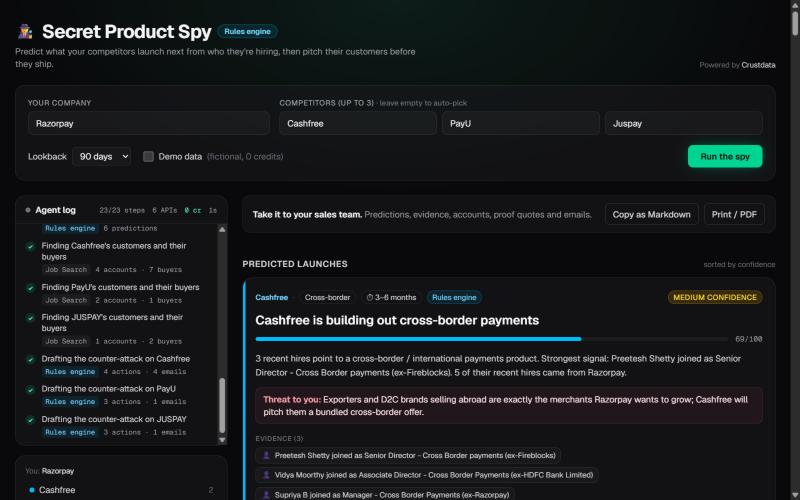
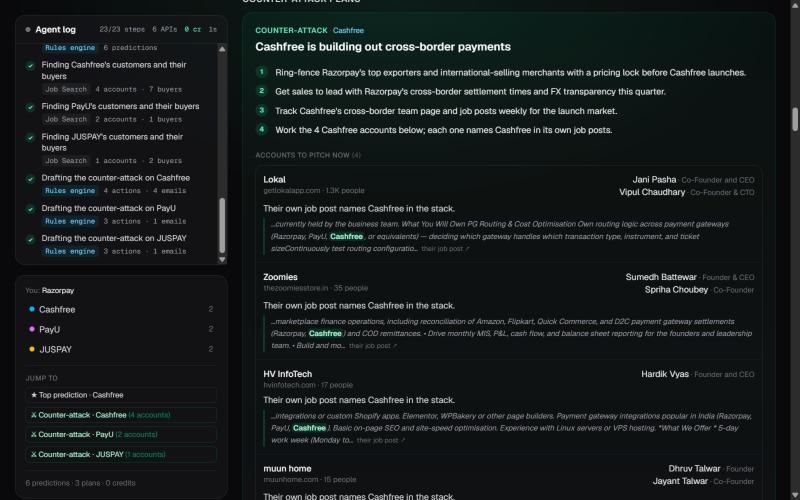

# Secret Product Spy

**Predict what a competitor will launch next from who it is hiring, then pitch its customers before it ships.**

Enter your company and up to three rivals. An agent reads their open roles, their new joiners and their news
through [Crustdata](https://crustdata.com), predicts each rival's next launch with linked evidence, and builds a
counter-attack: the rival's customers (proved by those customers' own job posts), the buyer at each, and
ready-to-send emails.





_Real run, Razorpay vs Cashfree, PayU, Juspay (Demo data unticked), 90-day lookback._

## How it works

```
 INPUT  you = Razorpay, rivals = Cashfree, PayU, Juspay, lookback = 90 days
   │
 1 RESOLVE         Company Identify + Company Enrichment   who they are; rivals auto-picked if left empty
 2 HIRING INTENT   Job Search (+ aggregations)             open roles by function, country, title
 3 WHO JOINED      People Search + Person Enrichment       new joiners, their skills and previous employers
 4 CONTEXT         Web Search + Web Fetch                  recent news, read in full
 5 PREDICT         rules engine or Claude                  themes like cross-border, crypto, lending, AI agents,
   │                                                       each prediction cites ≥2 real jobs / hires / articles
 6 COUNTER-ATTACK  Job Search                              other companies whose job posts name the rival as their gateway
   │               Web Search + Web Fetch                  case studies on the rival's own site
   │               Company Identify + Company Search       resolve and size those accounts, drop payments companies
   │               People Search                           founder / CXO buyer at each account
   │               rules engine or Claude                  action plan + one email per buyer
   ▼
 OUTPUT  live NDJSON stream → agent log, predictions, dossiers, plans; Copy as Markdown / Print
```

## Crustdata APIs used (9)

| API | What it does here |
|---|---|
| Company Autocomplete | Typeahead in the company inputs (free) |
| Company Identify | Turns names into Crustdata company IDs: you, rivals, and the customer accounts we find |
| Company Enrichment | Headcount, growth, funding, HQ, and known competitors (used to auto-pick rivals) |
| Company Search | Sizes target accounts and filters out other payments companies |
| Job Search | The rival's open roles in the lookback window, plus other companies' job posts that name the rival |
| People Search | People who joined the rival recently; the founder or CXO buyer at each target account |
| Person Enrichment | Deep profile of the most senior new hires: skills and previous employers |
| Web Search | Recent news about each rival; case-study pages |
| Web Fetch | Reads the top articles and customer pages in full |

Every response is cached in `.cache/crustdata/`, so a repeated run costs 0 credits. A cold run of the demo set
(3 rivals) cost about 67 credits on our machine.

## Run locally

```bash
cp .env.example .env.local   # add CRUSTDATA_API_KEY; ANTHROPIC_API_KEY is optional
npm install
npm run dev
```

Open http://localhost:3000, type your company and rivals, untick **Demo data**, and click **Run the spy**.

## Three modes, one UI

| Mode | When | Data | Predictions and emails |
|---|---|---|---|
| **Demo data** | "Demo data" ticked, `?mock=1`, `CRUSTDATA_MOCK=1`, or no Crustdata key | Fictional companies and people, offline, 0 credits | Curated fixture |
| **Live + rules engine** | `CRUSTDATA_API_KEY` set, no `ANTHROPIC_API_KEY` | Real Crustdata data | Transparent keyword and seniority rules (badge: "Rules engine") |
| **Live + Claude** | Both keys set | Real Crustdata data | Claude (`claude-opus-5-5`), with every cited job, hire or URL checked against the dossier |

If a Claude call fails, that step falls back to the rules engine. If a live run errors or goes quiet for 25 s, the
page offers to show the demo data instead. On a public deploy, set `SPY_ACCESS_CODE` and open the site as
`/?key=<code>` to get live data; without the code it serves demo data.

## More

- 2-minute demo script and likely questions: [ROADMAP.md §5](ROADMAP.md)
- How two Claude agents split the build: [CLAUDE.md](CLAUDE.md)
- Data contract between pipeline and UI: [src/lib/types.ts](src/lib/types.ts)
